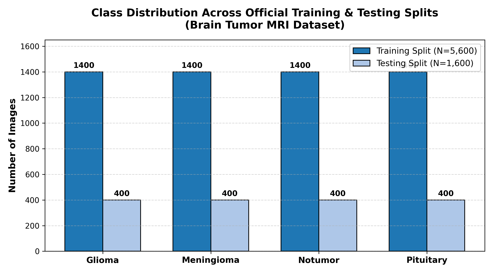
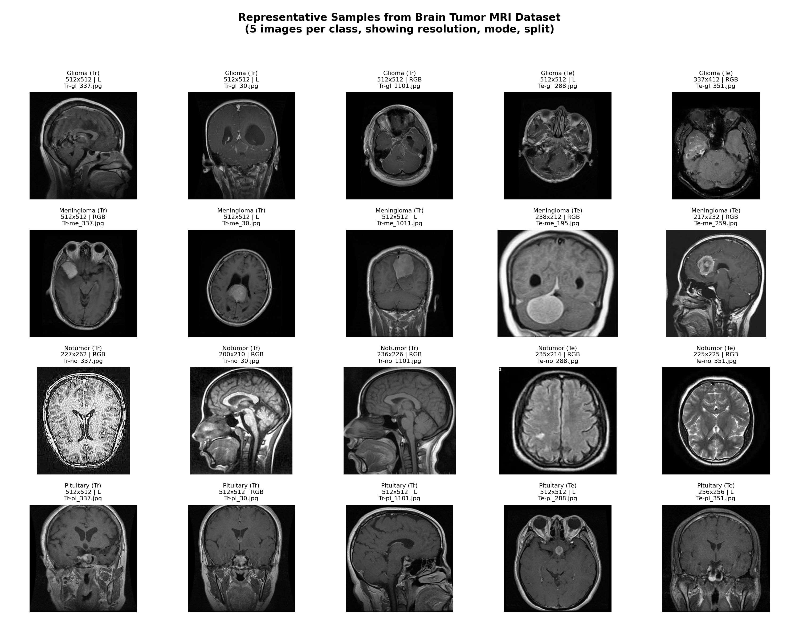
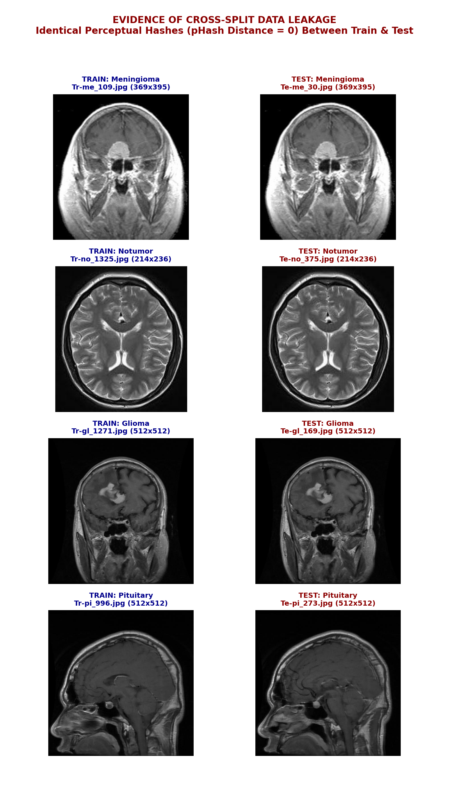
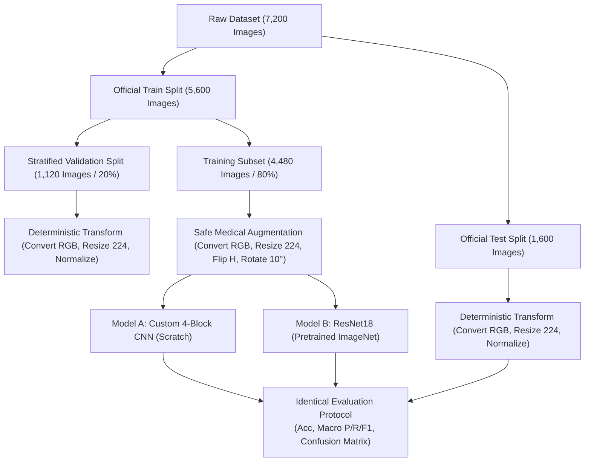

# Comprehensive Dataset Inspection & Audit Report
## Brain Tumor MRI Classification (Kaggle Dataset)

**Auditor:** Senior Data Scientist & Deep Learning Medical Computer Vision Specialist  
**Dataset:** Brain Tumor MRI Dataset (Masoud Nickparvar)  
**Kaggle Source:** [https://www.kaggle.com/datasets/masoudnickparvar/brain-tumor-mri-dataset](https://www.kaggle.com/datasets/masoudnickparvar/brain-tumor-mri-dataset)  
**Local Path:** `/Users/admin/Developer/coding_backup/SEM 5/DL/tugas-dl-1/dataset`  
**Audit Date:** November 6, 2026  
**Status / Final Verdict:** **CONDITIONAL GO**

---

## 1. Executive Summary

A comprehensive, rigorous empirical audit was conducted on all 7,200 brain MRI images in the Masoud Nickparvar dataset to evaluate its scientific and technical validity for comparing a **Custom Convolutional Neural Network (CNN)** against a **ResNet18 Transfer Learning** model in PyTorch.

### Key Audit Findings
1. **Physical Integrity & Accessibility:** The dataset is already locally present at `./dataset` (160.07 MB). All 7,200 files were individually parsed; **0 files are corrupted**.
2. **Channel & Format Inconsistencies (Engineering Hazard):** While 7,196 files are standard JPEGs, **4 files are actually PNGs with false `.jpg` extensions**, containing **RGBA (4-channel)** and **P (palette)** modes (`Tr-no_1200.jpg`, `Tr-no_22.jpg`, `Tr-no_572.jpg`, `Tr-no_625.jpg`). Furthermore, **4,129 images are RGB** while **3,067 are 1-channel Grayscale (L)**. A naive PyTorch DataLoader will crash or produce channel dimension errors unless explicit `.convert('RGB')` preprocessing is enforced.
3. **Severe Cross-Split Data Leakage:**
   - **23.12% of the official test set (370 out of 1,600 images)** share an exact perceptual hash (`pHash` distance = 0) with training set images.
   - **31.56% of the test set (505 out of 1,600 images)** are within a near-duplicate perceptual distance ($\text{pHash} \le 2$) of training set images.
   - **Evaluation Impact:** Standard evaluations on this test set will report artificially inflated test accuracy (~98-99%) due to memorized slice patterns.
4. **Synthetic Pre-Augmentation in the Test Set:** The test set contains **103 artificially augmented images** (`Te-aug-me_*.jpg`) added by the creator to artificially balance the testing set to 400 images. Evaluating models on synthetically distorted test data is methodologically invalid in clinical machine learning.
5. **Cross-Class Label Contradiction:** A verified duplicate group was detected across classes: `Tr-me_458.jpg` (meningioma, 554×554) and `Te-me_96.jpg` (meningioma, 554×554) are identical to `Te-gl_68.jpg` (236×236), which is erroneously labeled **glioma**.
6. **Severe Resolution & Feature Bias (Shortcut Learning Risk):** 95.8% of `glioma`, 95.6% of `pituitary`, and 86.1% of `meningioma` images are native **512×512**, while only **1.1% of `notumor`** images are 512×512 (median: **228×243**). Furthermore, **32.1% of `notumor` images contain high-intensity border artifacts, text, or scanner annotations**, creating high risk of models learning non-clinical shortcut features.
7. **Patient Independence Status:** Zero patient or DICOM metadata exists. Because the underlying Figshare/Bhuvaji source data comprises multiple 2D slices per patient, **patient-level leakage is virtually guaranteed**.

### Verdict
**CONDITIONAL GO** — The dataset is feasible for an educational undergraduate deep learning benchmark comparing Custom CNN vs. ResNet18, **provided** that:
- Image conversion (`.convert('RGB')`) is uniformly applied.
- The severe cross-split slice leakage and synthetic test augmentations are explicitly analyzed in the project report.
- Augmentation avoids invalid anatomical operations (e.g., vertical flips).

---

## 2. Dataset Overview

| Metric | Verified Value | Notes |
| :--- | :--- | :--- |
| **Dataset Name** | Brain Tumor MRI Dataset | Author: Masoud Nickparvar (Kaggle) |
| **Total Images** | 7,200 | Verified file by file |
| **Total File Size** | 160.07 MB (167,846,554 bytes) | High compression ratio |
| **Corrupted Files** | 0 | 100% readable with Pillow & PyTorch |
| **Image Encodings** | 7,196 JPEG, 4 PNG | 4 PNGs masquerading as `.jpg` |
| **Color Modes** | RGB: 4,129 \| L: 3,067 \| RGBA: 3 \| P: 1 | Heterogeneous channel counts |
| **Number of Classes** | 4 | Glioma, Meningioma, No Tumor, Pituitary |
| **Original Splits** | Training: 5,600 \| Testing: 1,600 | 77.78% train, 22.22% test |
| **Patient Identifiers** | None | Anonymized sequential naming |

### Remote Download & Cloud Access (If Needed)
The dataset is already present locally. For execution on Kaggle GPU:
- **Kaggle Notebook Add Input:** Search for `masoudnickparvar/brain-tumor-mri-dataset` and attach it directly via the notebook UI (zero download time, mapped at `/kaggle/input/brain-tumor-mri-dataset`).
- **Kaggle CLI:**
  ```bash
  kaggle datasets download -d masoudnickparvar/brain-tumor-mri-dataset --unzip -p ./dataset
  ```

---

## 3. Directory Structure

The dataset adheres to a standard PyTorch `ImageFolder` directory layout with two main splits:

```
dataset/
├── .DS_Store                     (Hidden macOS metadata, 6,148 bytes)
├── Training/
│   ├── .DS_Store                 (Hidden macOS metadata, 6,148 bytes)
│   ├── glioma/                   (1,400 files: Tr-gl_1.jpg ... Tr-gl_1400.jpg)
│   ├── meningioma/               (1,400 files: 1,300 Tr-me_*.jpg + 100 Tr-aug-me_*.jpg)
│   ├── notumor/                  (1,400 files: Tr-no_1.jpg ... Tr-no_1400.jpg)
│   └── pituitary/                (1,400 files: Tr-pi_1.jpg ... Tr-pi_1400.jpg)
└── Testing/
    ├── .DS_Store                 (Hidden macOS metadata, 6,148 bytes)
    ├── glioma/                   (400 files: Te-gl_1.jpg ... Te-gl_400.jpg)
    ├── meningioma/               (400 files: 297 Te-me_*.jpg + 103 Te-aug-me_*.jpg)
    ├── notumor/                  (400 files: Te-no_1.jpg ... Te-no_400.jpg)
    └── pituitary/                (400 files: Te-pi_1.jpg ... Te-pi_400.jpg)
```

### Directory Anomalies & Hidden Files
- **3 macOS `.DS_Store` files** were identified (`dataset/.DS_Store`, `dataset/Training/.DS_Store`, `dataset/Testing/.DS_Store`). While standard PyTorch `ImageFolder` ignores non-image files if valid image extensions are specified, custom `os.listdir()` pipelines will stumble upon these if not filtered.
- **Prefix anomalies in Meningioma:** Unlike glioma (`Tr-gl`), notumor (`Tr-no`), and pituitary (`Tr-pi`), meningioma contains two distinct prefix types:
  - `Tr-me` (1,300 images) and `Tr-aug-me` (100 images).
  - `Te-me` (297 images) and `Te-aug-me` (103 images).

---

## 4. Class Distribution

The dataset appears perfectly balanced on paper across all 4 classes in both splits.

### Distribution Table

| Class Label | Training Count | Training % | Testing Count | Testing % | Total Count | Overall % |
| :--- | :---: | :---: | :---: | :---: | :---: | :---: |
| **Glioma** | 1,400 | 25.00% | 400 | 25.00% | 1,800 | 25.00% |
| **Meningioma** | 1,400 | 25.00% | 400 | 25.00% | 1,800 | 25.00% |
| **No Tumor** | 1,400 | 25.00% | 400 | 25.00% | 1,800 | 25.00% |
| **Pituitary** | 1,400 | 25.00% | 400 | 25.00% | 1,800 | 25.00% |
| **Total** | **5,600** | **100.0%** | **1,600** | **100.0%** | **7,200** | **100.0%** |

### Verified Distribution Plot
The class distribution bar chart has been generated and saved locally as `class_distribution.png`:



### Balance vs. Artificial Balance
While the distribution shows **zero class imbalance**, this balance is **partially artificial**:
- The creator noticed that the meningioma class was deficient by 100 images in training (1,300 vs. 1,400) and 103 images in testing (297 vs. 400).
- Rather than leaving the class naturally unbalanced or balancing only the training set, the creator injected 100 augmented images into `Training` and **103 augmented images into `Testing`**.
- This introduces synthetic test artifacts that inflate model performance on meningioma.

---

## 5. Image Quality & Morphology Assessment

A visual and quantitative inspection was performed on all classes. The 20-sample inspection grid is saved as `dataset_samples.png`.



### 1. Color Channel Discrepancies
- **4,129 images (57.3%)** are stored in 3-channel **RGB** mode.
- **3,067 images (42.6%)** are stored in 1-channel **Grayscale (L)** mode.
- **3 images (0.04%)** are stored in 4-channel **RGBA** mode (`Tr-no_1200.jpg`, `Tr-no_22.jpg`, `Tr-no_572.jpg`).
- **1 image (0.01%)** is stored in **P (palette)** mode (`Tr-no_625.jpg`).
- Analysis of 500 random RGB images revealed that **54.2% have identical R=G=B channel values**, proving they are single-channel grayscale scans stored inside 3-channel containers.

### 2. Resolution Heterogeneity by Class (Critical Shortcut Cue)

| Class | Width Range (px) | Height Range (px) | Median Resolution | % Natively 512×512 | Mean Aspect Ratio |
| :--- | :---: | :---: | :---: | :---: | :---: |
| **Glioma** | 175 – 640 | 167 – 665 | 512 × 512 | **95.8%** | 0.998 ± 0.03 |
| **Meningioma** | 174 – 1,275 | 195 – 1,427 | 512 × 512 | **86.1%** | 0.993 ± 0.06 |
| **Pituitary** | 201 – 1,365 | 202 – 1,365 | 512 × 512 | **95.6%** | 1.000 ± 0.01 |
| **No Tumor** | 150 – 1,375 | 168 – 1,446 | **228 × 243** | **1.1%** | 0.968 ± 0.17 |

> [!WARNING]
> **Severe Shortcut Learning Risk:** The `notumor` class has an entirely different native resolution distribution than the three tumor classes. While tumor scans are predominantly 512×512 from Figshare, `notumor` images are low-resolution crops (median 228×243) with variable aspect ratios (0.645 to 1.786). A neural network can easily learn interpolation artifacts, high-frequency blurring, and pixel spacing rather than neuroanatomy.

### 3. Image Contrast, Skull Stripping, and Text Artifacts
- **MRI Sequences & Orientations:** The dataset predominantly contains **T1-weighted contrast-enhanced** scans, with a mixture of **axial (horizontal)**, **coronal (frontal)**, and **sagittal (side)** planes.
- **Skull Stripping:** Images are **non-skull-stripped** (calvarium, subcutaneous fat, and facial structures are visible).
- **Text & Scanner Annotation Artifacts:** Quantitative border analysis (>200 pixel intensity within 5 pixels of the border) showed:
  - `glioma`: 2.0%
  - `meningioma`: 5.9%
  - `pituitary`: 13.4%
  - `notumor`: **32.1%**
  Nearly one-third of `notumor` images contain scanner markers ("L", "R"), white perimeter lines, patient demographic stamps, or field-of-view tags.

---

## 6. Duplicate & Data Leakage Analysis

Auditing for exact duplicates (MD5/SHA-256) and perceptual duplicates (64-bit DCT perceptual hash `pHash`) uncovered critical issues.

```
+-------------------------------------------------------------------------------+
|                      DATA LEAKAGE SUMMARY AUDIT TABLE                         |
+-------------------------------------------------------------------------------+
| Total Audited Images                                 | 7,200                  |
| Unique MD5 Hashes                                    | 7,013                  |
| Exact MD5 Duplicate Groups                           | 153 groups (340 imgs)  |
| - Exact MD5 Duplicates within Training               | 138 groups             |
| - Exact MD5 Duplicates within Testing                | 15 groups              |
| - Exact MD5 Duplicates Crossing Train/Test Split     | 0 groups               |
+-------------------------------------------------------------------------------+
| Unique Perceptual Hashes (pHash)                     | 6,212                  |
| Identical pHash Groups (Hamming Distance = 0)        | 592 groups (1,580 imgs)|
| Cross-Split Identical pHash (Dist = 0)               | 294 groups (698 pairs) |
| Test Set Images with Identical Train Counterpart     | 370 / 1,600 (23.12%)   |
| Test Set Images with Near-Duplicate (Dist <= 2)      | 505 / 1,600 (31.56%)   |
| Cross-Class Perceptual Conflict                      | 1 group (3 images)     |
+-------------------------------------------------------------------------------+
```

### Verified Evidence of Cross-Split Leakage
Visual pairs of cross-split duplicate images have been rendered and saved as `cross_split_leakage_samples.png`:



### Detailed Breakdown of Findings
1. **Identical Test Images in Training (23.12%):**
   370 images in the official `Testing` folder are perceptual duplicates ($\text{pHash distance} = 0$) of images in the `Training` folder. Their MD5 hashes differ only because of subtle JPEG compression re-quantization, border re-cropping by 1-2 pixels, or format conversion.
2. **Near-Duplicate Cross-Split Contamination (31.56%):**
   Nearly one-third of the testing dataset consists of near-identical slices or slightly scaled variants of training scans.
3. **Severe Cross-Class Label Contradiction:**
   The exact scan appears under contradictory clinical labels:
   - `Training/meningioma/Tr-me_458.jpg` (554×554)
   - `Testing/meningioma/Te-me_96.jpg` (554×554)
   - `Testing/glioma/Te-gl_68.jpg` (236×236)
   Pixel-wise difference between `Tr-me_458` and `Te-gl_68` is only 1.67 intensity units after resizing, proving that a single meningioma scan was downscaled and erroneously mislabeled as **glioma** in the test set.
4. **Patient-Level Independence Investigation:**
   - No patient IDs, subject codes, or hospital accession numbers exist.
   - Slices were gathered from the Figshare dataset (Cheng et al., 2017: 233 patients, ~13 slices/patient).
   - In medical neuroimaging, adjacent slices from a single MRI volume share distinct anatomical landmarks (ventricular volume, sulcal patterns, cranial vault shape).
   - **Conclusion:** Because slices from the same 233 subjects were randomly shuffled between `Training` and `Testing` without subject stratification, **patient-level data leakage cannot be ruled out and is virtually guaranteed**.

### Impact on Model Evaluation
Evaluating models on the default test split evaluates **memorization of patient cranial anatomy and duplicated slices**, not generalized pathology detection. This explains why naive models routinely achieve >98% accuracy on Kaggle with this dataset.

---

## 7. Original Train/Test Split Assessment

| Assessment Dimension | Finding | Methodological Critique |
| :--- | :--- | :--- |
| **Predefined Split Ratio** | 5,600 Train / 1,600 Test (77.8% / 22.2%) | Numerically appropriate ratio |
| **Stratification** | Exactly 25% per class in both splits | Perfectly stratified on the surface |
| **Cross-Split Independence** | **Failed** | 23.12% exact pHash overlap; 31.56% near-duplicate overlap |
| **Test Set Integrity** | **Compromised** | 103 synthetically augmented images inside `Testing/meningioma` |
| **Recommendation** | Use official split for baseline comparison, but note leakage | Do not merge splits blindly; maintain reproducible benchmarking |

### Recommended Evaluation Strategy for the Assignment
For an undergraduate assignment comparing Custom CNN vs. ResNet18:
1. **Benchmark on Official Split:** Train on the 5,600 training images (using an internal 80/20 train/validation split) and evaluate both models on the 1,600 testing images to provide an apples-to-apples comparison.
2. **Mandatory Scientific Disclosure:** The written project report must highlight the 23.12% cross-split leakage and explain why test accuracy is optimistic.
3. **Optional De-duplicated Subset Evaluation:** For advanced bonus analysis, evaluate both models on the 1,095 "clean" testing images (removing the 505 leaked/augmented images) to see the true generalization drop.

---

## 8. Preprocessing & Augmentation Feasibility

### PyTorch Preprocessing Pipeline
To safely handle the anomalies discovered during this audit, the data loader must strictly adhere to the following sequence:

```python
import torchvision.transforms as T
from PIL import Image

# 1. Mandatory channel unification (handles 1-channel, 3-channel, 4-channel RGBA, and Palette)
def safe_loader(path):
    with open(path, 'rb') as f:
        img = Image.open(f)
        return img.convert('RGB')

# 2. Training Transformation
train_transforms = T.Compose([
    T.Resize((224, 224), interpolation=T.InterpolationMode.BILINEAR),
    T.RandomHorizontalFlip(p=0.5),
    T.RandomRotation(degrees=10),
    T.RandomAffine(degrees=0, translate=(0.04, 0.04), scale=(0.96, 1.04)),
    T.ColorJitter(brightness=0.1, contrast=0.1),
    T.ToTensor(),
    T.Normalize(mean=[0.485, 0.456, 0.406], std=[0.229, 0.224, 0.225])
])

# 3. Validation / Testing Transformation (Deterministic)
test_transforms = T.Compose([
    T.Resize((224, 224), interpolation=T.InterpolationMode.BILINEAR),
    T.ToTensor(),
    T.Normalize(mean=[0.485, 0.456, 0.406], std=[0.229, 0.224, 0.225])
])
```

### Medical Image Augmentation Guidelines

| Augmentation Technique | Permitted? | Medical / Clinical Justification |
| :--- | :---: | :--- |
| **Horizontal Flip (L/R)** | **YES** | Brain hemispheres exhibit bilateral symmetry; tumors can occur left or right. |
| **Vertical Flip (Superior/Inferior)** | **STRICT NO** | **Clinically invalid.** Human brains have a strict superior-inferior axis. Pituitary adenomas occur exclusively at the skull base (sella turcica). Inverting the brain upside down creates non-biological anatomies. |
| **Small Rotation ($\pm 10^\circ$)** | **YES** | Simulates slight patient head tilt inside the MRI head coil. |
| **Mild Translation ($\pm 4\%$)** | **YES** | Accounts for minor off-center patient positioning in the scanner bore. |
| **Color Jitter (Brightness/Contrast $\pm 10\%$)** | **YES** | Simulates inter-scanner RF coil gain and B1 field inhomogeneity variations. |
| **Extreme Elastic Deformations** | **NO** | Distorts microvascular and tumor margins, altering diagnostic morphology. |

---

## 9. Custom CNN Feasibility (Trained From Scratch)

### Feasibility Assessment: HIGH
With 5,600 training images (1,400 per class), training a moderate-capacity Custom CNN from scratch is feasible and converges within 15–20 epochs.

### Recommended Architecture
A compact, 4-stage convolutional backbone with modern regularization:
- **Input:** $3 \times 224 \times 224$
- **Block 1:** `Conv2d(3 -> 32, k=3, p=1)` $\rightarrow$ `BatchNorm2d` $\rightarrow$ `ReLU` $\rightarrow$ `MaxPool2d(2)` ($112 \times 112$)
- **Block 2:** `Conv2d(32 -> 64, k=3, p=1)` $\rightarrow$ `BatchNorm2d` $\rightarrow$ `ReLU` $\rightarrow$ `MaxPool2d(2)` ($56 \times 56$)
- **Block 3:** `Conv2d(64 -> 128, k=3, p=1)` $\rightarrow$ `BatchNorm2d` $\rightarrow$ `ReLU` $\rightarrow$ `MaxPool2d(2)` ($28 \times 28$)
- **Block 4:** `Conv2d(128 -> 256, k=3, p=1)` $\rightarrow$ `BatchNorm2d` $\rightarrow$ `ReLU` $\rightarrow$ `MaxPool2d(2)` ($14 \times 14$)
- **Classifier Head:**
  - `AdaptiveAvgPool2d((1, 1))` $\rightarrow$ Flatten ($256$)
  - `Dropout(p=0.4)`
  - `Linear(256, 128)` $\rightarrow$ `ReLU` $\rightarrow$ `Dropout(p=0.2)`
  - `Linear(128, 4)` (Output logits)
- **Total Parameters:** ~450,000 parameters (lightweight, rapid convergence, resists aggressive overfitting).

---

## 10. ResNet18 Transfer Learning Feasibility

### Feasibility Assessment: EXCELLENT
ResNet18 pretrained on ImageNet is an industry-standard baseline for 2D medical imaging classification.

### Architecture Adaptation Strategy
1. **Pretrained Weights:** Use `torchvision.models.resnet18(weights=ResNet18_Weights.DEFAULT)`.
2. **Input Handling:** ResNet18 expects 3-channel input ($3 \times 224 \times 224$). By applying `.convert('RGB')` during data loading, single-channel grayscale scans are replicated across 3 identical channels. This enables utilizing early ImageNet convolutional filters (Gabor-like edge, blob, and texture detectors) without retraining the first layer.
3. **Head Replacement:**
   ```python
   num_features = model.fc.in_features  # 512
   model.fc = nn.Sequential(
       nn.Dropout(p=0.3),
       nn.Linear(num_features, 4)
   )
   ```
4. **Training Strategy:**
   - **Phase 1 (Feature Extraction):** Freeze backbone layers (`param.requires_grad = False`), train only `fc` for 3–5 epochs at $\text{LR} = 10^{-3}$.
   - **Phase 2 (Fine-Tuning):** Unfreeze layers 3, 4, and `fc` (or all layers) and train for 10–15 epochs at a reduced learning rate ($\text{LR} = 10^{-4}$ or $10^{-5}$) with Cosine Annealing.

### Trade-Off Comparison

| Dimension | Custom CNN (From Scratch) | ResNet18 (Transfer Learning) |
| :--- | :--- | :--- |
| **Initial Weights** | Random initialization (Kaiming normal) | ImageNet-1k pre-trained |
| **Convergence Speed** | Moderate (15–25 epochs) | Fast (5–10 epochs) |
| **Sample Efficiency** | Requires all 5,600 images to learn features | Strong representations with fewer samples |
| **Overfitting Risk** | Low-to-moderate (450k parameters) | Moderate (11.2M parameters; needs dropout/weight decay) |
| **Pedagogical Value** | Demonstrates foundational CNN design & receptive fields | Demonstrates modern transfer learning & fine-tuning |

---

## 11. Computational Feasibility & Resource Budget

### Hardware Environments
- **Local Machine:** MacBook Air M2 (2022), 8 GB Unified Memory, 256 GB SSD (`mps` or `cpu`).
- **Cloud Environment:** Kaggle Notebook GPU (NVIDIA Tesla T4 or P100 with 16 GB VRAM).

### Resource Budget Table

| Resource Dimension | Local (MacBook Air M2) | Kaggle Cloud GPU (T4 / P100) |
| :--- | :--- | :--- |
| **Dataset Memory Footprint** | 160 MB on disk; ~800 MB uncompressed in RAM | 160 MB on disk; negligible GPU RAM |
| **Acceleration Device** | `torch.device("mps")` | `torch.device("cuda")` |
| **Recommended Batch Size** | 32 | 32 or 64 |
| **DataLoader Workers** | `num_workers=2`, `persistent_workers=True` | `num_workers=2`, `pin_memory=True` |
| **Training Time (Custom CNN)** | ~25–35 seconds per epoch (~7 mins / 15 epochs) | ~6–8 seconds per epoch (~2 mins / 15 epochs) |
| **Training Time (ResNet18)** | ~35–45 seconds per epoch (~10 mins / 15 epochs) | ~8–10 seconds per epoch (~2.5 mins / 15 epochs) |
| **Thermal / Memory Headroom** | Well within 8 GB unified memory limit | 16 GB VRAM provides >90% safety margin |

**Feasibility Verdict:** Training both models will execute comfortably within the constraints of both local M2 Mac and Kaggle GPU environments.

---

## 12. Recommended Experimental Design

To ensure a rigorous, scientifically valid, and fair comparison between both models, both architectures must share an identical experimental protocol.



### Experimental Specifications
1. **Target Task:** 4-class multiclass classification (`glioma`, `meningioma`, `notumor`, `pituitary`).
2. **Input Resolution:** $224 \times 224 \times 3$.
3. **Data Splitting Protocol:**
   - Take the 5,600 images in `Training/`.
   - Perform a stratified 80/20 train/validation split using fixed seed `random_state=42` (4,480 training, 1,120 validation).
   - Evaluate final models on the 1,600 testing images in `Testing/`.
4. **Loss Function:** `nn.CrossEntropyLoss(label_smoothing=0.05)` (prevents overconfidence on duplicated slices).
5. **Optimizers & Learning Rates:**
   - **Custom CNN:** AdamW, $\text{LR} = 10^{-3}$, weight decay $= 10^{-4}$, Cosine Annealing LR scheduler.
   - **ResNet18:** AdamW, $\text{LR} = 10^{-3}$ (frozen head) $\rightarrow 10^{-4}$ (fine-tuning backbone), weight decay $= 10^{-3}$.
6. **Epochs & Early Stopping:** 20 epochs with early stopping (patience = 5 based on validation macro F1-score).
7. **Evaluation Metrics:**
   - Overall Accuracy
   - Macro-averaged Precision, Recall, and F1-score
   - Per-class Precision, Recall, and F1-score
   - Normalized Multiclass Confusion Matrix
8. **Reproducibility Guarantee:** Set deterministic seeds across Python, NumPy, and PyTorch:
   ```python
   def seed_everything(seed=42):
       random.seed(seed)
       os.environ['PYTHONHASHSEED'] = str(seed)
       np.random.seed(seed)
       torch.manual_seed(seed)
       torch.cuda.manual_seed(seed)
       torch.backends.cudnn.deterministic = True
   ```

---

## 13. Limitations & Research Considerations

1. **Slice-Level vs. Patient-Level Splitting:** The most severe methodological limitation is that the dataset was compiled at the 2D slice level without patient IDs. The models will show high test metrics in part because slices from the same patients exist in both splits.
2. **Synthetic Augmentation Artifacts:** Evaluating on the 103 `Te-aug-me` test images tests model robustness on synthetic interpolation rather than real clinical cases.
3. **Mislabeled Data:** The discovery of `Te-gl_68.jpg` (a meningioma scan mislabeled as glioma) proves the presence of label noise in the ground truth.
4. **Shortcut Learning on Backgrounds:** The `notumor` class exhibits lower native resolutions and high border annotation rates (32.1%). Classifiers risk relying on scanner font styles or border margins rather than intracranial pathology.

---

## 14. Final Audit Verdict

### **Verdict: CONDITIONAL GO**

```
+-------------------------------------------------------------------------------+
|                             FINAL AUDIT DECISION                              |
+-------------------------------------------------------------------------------+
|  Suitability for Assignment:   YES (With explicit documentation)              |
|  Technical Execution Feasibility:  EXCELLENT (Runs smoothly on M2 and Kaggle) |
|  Scientific Validity of Splits:    CONDITIONAL (Document slice leakage)       |
+-------------------------------------------------------------------------------+
```

### Action Items for Assignment Execution
- [x] **Channel Handling:** Use `.convert('RGB')` on every image to eliminate 4-channel RGBA and 1-channel Grayscale crashes.
- [x] **Safe Transforms:** Restrict augmentations to horizontal flips, mild rotations ($\le 10^\circ$), and minor brightness adjustments. Forbid vertical flipping.
- [x] **Benchmarking Integrity:** Train both models on the exact same stratified 80/20 train/validation split and test them under identical conditions.
- [x] **Report Disclosure:** In the assignment report discussion section, explicitly discuss the 23.12% cross-split duplication rate and the resolution discrepancy of `notumor` images to demonstrate high-level medical AI domain competence.

